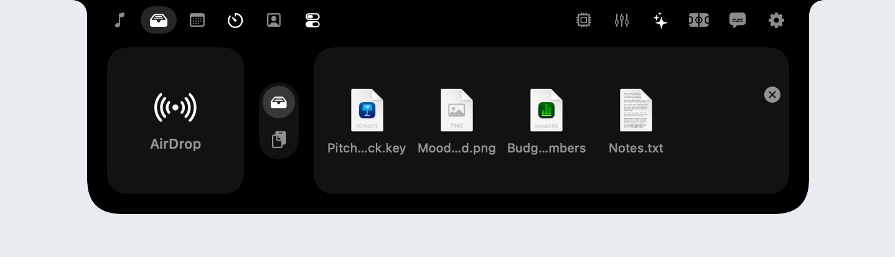
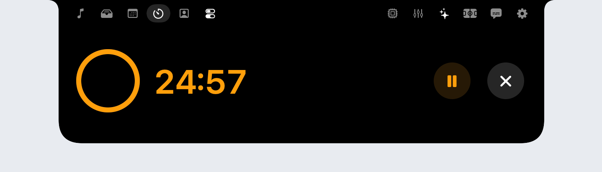
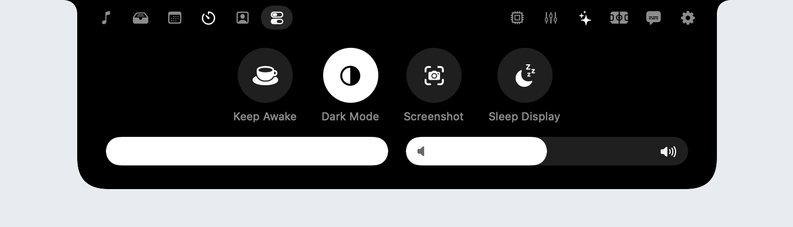
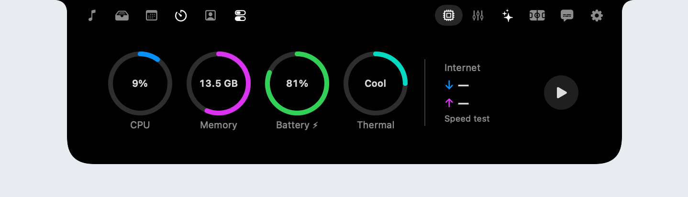

# Dynisland: A Dynamic Island for the MacBook Notch

**A Dynamic Island for your Mac.** Dynisland turns the notch into something useful. Move the pointer onto it and it opens into a panel with pages for music, a shelf for files, your calendar, a timer, quick controls, system stats and more. When it's closed it still shows small live activities next to the notch, like volume, charging or a running timer.

<p align="center">
  
  
</p>
<p align="center">
  
  
</p>
<p align="center">
  
</p>

<sub>Screenshots are the app's own views drawn to an image, on a plain background.</sub>

- **Platforms:** macOS 14.2+, best on a MacBook with a notch (without one it draws a notch under the menu bar)
- **Language:** Swift with SwiftUI and AppKit, plus a small Objective-C bridge for Now Playing. No third-party dependencies.
- **Privacy:** captions run on the device. The network is used only for lyrics, sports scores and the speed test.
- **Status:** still working on it (see [Status](#status-what-is-verified-and-what-isnt)).

---

## Contents

1. [What it does](#what-it-does)
2. [How it works](#how-it-works)
3. [Design](#design)
4. [Privacy](#privacy)
5. [Technologies](#technologies)
6. [Project structure](#project-structure)
7. [Build and run](#build-and-run)
8. [Status: what is verified and what isn't](#status-what-is-verified-and-what-isnt)

---

## What it does

Pages in the open island (each one can be turned off or reordered in Settings):

- **Music.** What's playing in any app, with controls and lyrics.
- **Shelf, AirDrop & Clipboard.** Drop files on the island to keep them for later, drop them on AirDrop to send them, or flip to your clipboard history.
- **Calendar.** This month's events.
- **Timer.** Quick timers and a Pomodoro.
- **Mirror.** A live camera preview.
- **Quick Controls.** Keep Awake, Dark Mode, Screenshot, Sleep Display, brightness and volume.
- **System.** CPU, memory, battery, thermal state and an internet speed test.
- **Volume Mixer.** A volume slider for each app that's playing sound.
- **AI Agents.** Claude Code, Claude, Codex and ChatGPT: which ones are working, and a banner when one is done.
- **Sports.** Live scores.
- **Captions & Prompter.** Live subtitles for whatever your Mac is playing, and a teleprompter right under the camera.

While it's closed:

- **Live activities** beside the notch: volume and brightness, charging, a running timer, a live score.
- **Banners** that drop out of the notch: AirPods connected, a timer finished, an agent finished, incoming notifications.
- **Downloads** show their progress.
- The island hides when a fullscreen app is in front, and can be hidden from screen sharing.

It opens as soon as the pointer comes near the notch (the distance is adjustable in Settings → General), always on the leftmost tab. Use ← and → to switch pages while the pointer is on the open island.

On first launch a short welcome tour shows how it works, lets you pick your pages and a look, and asks for each permission with a reason. Settings → General → Welcome tour brings it back.

---

## How it works

### The panel (`Sources/Dynisland/main.swift`)

A borderless, non-activating panel sits just above the menu bar, centred on the notch. Its transparent pixels let clicks fall through to the menu bar. It measures the real notch from the screen's safe area, and keeps its live-activity wings clear of the app's menus and the status items.

### The model (`Sources/Dynisland/IslandModel.swift`)

`IslandModel` is one `@Observable` object that owns every service (media, calendar, timer, clipboard, mixer, agents, sports, captions…) and decides what the island shows: open or closed, which page, which activity or banner.

### Now Playing (`Bridge/NowPlaying.m`, `Sources/Dynisland/Media.swift`)

A small Objective-C library reads the system-wide Now Playing info, so it works with Music, Spotify and browsers alike. The app runs it in a helper process and reads its output.

### Audio (`Sources/Dynisland/Audio.swift`, `Sources/Dynisland/Captions.swift`)

The Volume Mixer uses Core Audio process taps to change the volume of one app at a time. Captions tap the Mac's audio output and pass it to on-device speech recognition.

---

## Design

- **Shape.** The island grows out of the notch with flared top corners, so it looks like one piece with the hardware.
- **Colours.** Eight presets (Classic, Ember, Ocean, Forest, Grape, Lagoon, Dusk, Mono) set the island colour and the accent.
- **Pages.** Every page shares the same layout: tabs along the top, content in rounded tiles below.

---

## Privacy

- Captions use on-device speech recognition.
- Clipboard history skips anything a password manager marks as secret.
- Network requests: lyrics from LRCLIB, sports scores, and the speed test.
- Calendar, camera and speech access are asked for only when you open the page that needs them.

---

## Technologies

| Area | Frameworks and techniques |
| --- | --- |
| Language | Swift (SwiftUI, Observation) and a little Objective-C |
| Window | AppKit `NSPanel` above the menu bar, safe-area notch measuring |
| Audio | Core Audio process taps, AudioToolbox |
| Captions | Speech framework, on-device recognition |
| Calendar | EventKit |
| System | IOKit power sources, thermal state |
| Input | Accessibility and an event tap for media keys |

---

## Project structure

```
Dynisland/
├── Sources/Dynisland/
│   ├── main.swift          The notch panel and app delegate
│   ├── IslandModel.swift   What the island shows, and every service
│   ├── IslandView.swift    The island, banners, shelf and activities
│   ├── Media.swift         Now Playing and lyrics
│   ├── Widgets.swift       Calendar, timer, quick controls, system stats
│   ├── Audio.swift         Volume, media keys and the mixer
│   ├── Captions.swift      Live captions
│   ├── Prompter.swift      Teleprompter
│   ├── Agents.swift        AI agent status
│   ├── Online.swift        Speed test and sports
│   ├── Clipboard.swift     Clipboard history
│   ├── Notifications.swift Notification banners
│   ├── Settings.swift      The Settings window
│   ├── Onboarding.swift    First-launch welcome tour
│   └── Prefs.swift         Saved preferences
├── Bridge/NowPlaying.m     Now Playing helper
├── Dynisland.xcodeproj
├── build-app.sh            Command-line build into ./Dynisland.app
└── .github/                Banner and README screenshots
```

---

## Build and run

Requirements: Xcode 27 on macOS. Open `Dynisland.xcodeproj` and run, or build from the command line:

```bash
./build-app.sh
open Dynisland.app
```

Opening the app again while it runs shows Settings.

---

## Status: what is verified and what isn't

**Verified**

- Builds with Xcode 27. The screenshots were drawn from the island's own SwiftUI views in that build.

**Not verified yet**

- Every page was not checked by hand for this README, only the ones in the screenshots.
- There is no unit test target.

---

© 2026 Alessandro Signorile. All rights reserved.
